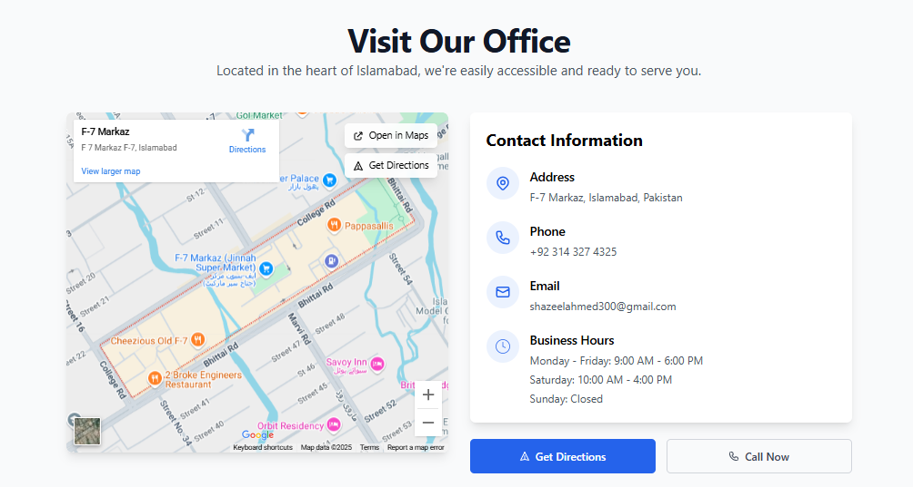
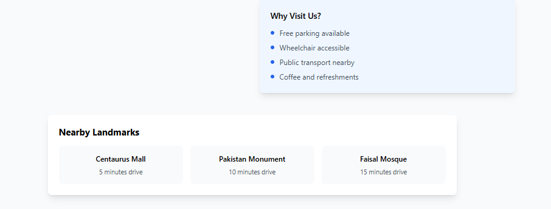

# Location Component

A configurable React 19 and TypeScript location section in Next.js 15, with an OpenStreetMap iframe and Google Maps navigation links. The default location and hours are demonstration data, not a real company office.




Existing screenshots preserve the original design; the maintained component now uses the configurable map and labelled sample data.

## Run

Node.js 22.19 or newer: `npm ci`, `npm run dev`, then http://localhost:3000. Production: `npm run build`, `npm start`. No map API key, billing setup or geolocation permission is required.

## Configure

```tsx
import Location from '@/components/map-location-section';
import {demoLocation} from '@/lib/location';
<Location locationData={{...demoLocation, name:'My configured location', latitude:33.7, longitude:73.1}} />
```

Configure `name`, `address`, `latitude`, `longitude`, optional `phone`/`email`, `hours`, and `demo`. Replace the sample data with verified details before using `demo:false`. The demo uses `example.com` and has no callable sample phone number. Invalid contact values do not become active links.

`lib/location.ts` validates coordinate bounds and produces all map URLs from the same point. The iframe contains an interactive third-party map; Open in Google Maps and Get Directions are ordinary external links with safe new-tab attributes. There is no Google Maps JavaScript API integration, real-time tracking, route calculation or custom map engine. Google performs navigation on its own site. See [Google Maps URL documentation](https://developers.google.com/maps/documentation/urls/get-started) and [OpenStreetMap sharing/export](https://wiki.openstreetmap.org/wiki/Export).

The map has a descriptive iframe title and attribution. Invalid coordinates show a fallback. A delayed load message offers direct navigation after ten seconds. Cross-origin iframe load events cannot prove tile rendering succeeded; the links remain usable if the embed is blocked. Both services receive normal browser requests; iframe loading requires connectivity.

## Structure and validation

`app/`: entry points and Tailwind styles; `components/`: location and used card/button primitives; `lib/`: coordinate/contact helpers; `public/`: original images; `legacy/index.html`: labelled standalone prototype, not served by Next.js.

Run `npm run typecheck`, `npm test`, `npm run build`. Three test groups cover matching coordinate URLs, invalid bounds and safe contact links. CI runs installation, types, tests and production build. The original 49 runtime dependencies were reduced to 8, and Next.js upgraded within version 15 to 15.5.27. The Tailwind 3 build chain retains seven npm audit findings (five high, two moderate), requiring a separately tested upstream fix or styling migration. No clean-audit claim is made.

## Hosting and future work

Ready for a Next.js-compatible host using `npm run build`; no public deployment was created. Future work could support multiple locations and optional consent before loading external maps. The archived prototype retains its old embed and unverified sample facilities/travel times under an explicit archive warning.

Author: Shazeel Ahmed. No license file is present.
